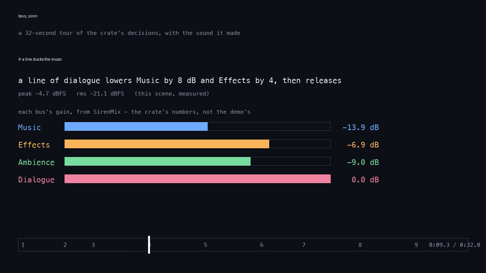

# bevy_siren

> ⚠️ **Vibe Coded.** Written by AI agents working from a human's direction, covered by tests rather than a line-by-line human review. Read the code before you rely on it for something you care about.

Sound for Bevy 0.20 that decides *what* plays and *how loud*: cues with variants, buses that duck, a voice budget that refuses politely, music that changes on the bar, and a log of what played and why.

[](https://crates.io/crates/bevy_siren)
[](https://docs.rs/bevy_siren)
[](https://github.com/bevy-coven/bevy_siren/actions/workflows/ci.yml)
[](https://bevyengine.org)
[](#who-and-licence)

**Status:** usable · Bevy 0.20 · MSRV 1.97.1

**Why:** Bevy gives you an `AudioPlayer` and a mixer. What every game still rebuilds on top is the part that decides *what* to play and *how loud* — a footstep that does not machine-gun, dialogue that steps the music back, a firefight that does not spawn four hundred sinks, a track whose combat layer comes in without cutting the tune, and a line that says why the music went quiet. `bevy_siren` makes that one crate's worth of it shared.

## Quick start

```sh
cargo add bevy_siren
```

```rust,no_run
use bevy::prelude::*;
use bevy_siren::*;

fn main() {
    App::new()
        .add_plugins((DefaultPlugins, SirenPlugin))
        .add_systems(Startup, setup)
        .add_systems(Update, (walk, report))
        .run();
}

fn setup(mut cue_table: ResMut<CueTable>, mut sounds: ResMut<SirenSounds>, assets: Res<AssetServer>) {
    // A cue with two variants: the picker never plays the same one twice in a row.
    // A sound key is a file's name under `assets/audio/`, extension included.
    cue_table.insert(Cue {
        sounds: vec![SoundSlot::new("step_01.ogg"), SoundSlot::new("step_02.ogg")],
        ..Cue::new("footstep.grass")
    });
    sounds.load_table(&assets, &cue_table, "audio");
}

// A footstep every half second.
fn walk(mut play: MessageWriter<Play>, time: Res<Time>, mut elapsed: Local<f32>) {
    *elapsed += time.delta_secs();
    if *elapsed >= 0.5 {
        *elapsed -= 0.5;
        play.write(Play::cue("footstep.grass"));
    }
}

// What the crate decided, once each, in its own words: which recording played, or why nothing did.
fn report(log: Res<SirenLog>, mut seen: Local<u64>) {
    for entry in log.since(*seen) {
        info!("{}", entry.line());
    }
    *seen = log.pushed();
}
```

A sound key is a file's name under `assets/audio/`, extension included. Put two short recordings there as `step_01.ogg` and
`step_02.ogg`, or run `cargo run --example quick_start` in a clone, which plays the two this repository ships. The console
is the crate's own log, so a footstep reads ``0.50s played `footstep.grass` (step_02.ogg) on Effects at 0.00 dB``, a
misspelt cue reads ``refused `footstep.grss`: no cue of that name`` **without any code of yours printing it**, and a key
with no file reads ``refused `footstep.grass`: the file for sound `step_03.ogg` failed to load: Path not found:
…/assets/audio/step_03.ogg``.

This block is `examples/quick_start.rs`, the file `tests/quick_start.rs` **runs** (the real asset server, Bevy's own audio
loader, the two files, the console read back), and the crate-root doc and this README are held to it:
`cargo test --features readme-example --test all readme::`.

From git, for changes not released yet:

```toml
[dependencies]
bevy_siren = { git = "https://github.com/bevy-coven/bevy_siren" }
```

Features: `serde` (the cue table, the mix table and the score as RON) and `mixer` (the crate's own summing graph, one
number per bus per frame). Both answer `Played`, `Refused` and `Voice` identically; only the sample path differs.

## Try it

**▶ [Play the tour — 32 seconds, with sound](https://cdn.jsdelivr.net/gh/bevy-coven/bevy_siren@main/docs/media/demo/tour.mp4)**
(763 KB MP4; the link serves `video/mp4`, so a browser plays it in place rather than downloading it), or
`cargo run --example demo` for the same nine scenes in a window with a live panel and keys.

[](https://cdn.jsdelivr.net/gh/bevy-coven/bevy_siren@main/docs/media/demo/tour.mp4)

*Frame 9.3 s of the video: a line of dialogue holding `Music` down by 8 dB and `Effects` by 4, the crate's own numbers. Click it to play.*

> **A README cannot hold a player, and this one does not pretend to.** GitHub strips `<audio>` and `<video>` from a README —
> measured with GitHub's own renderer, both come back as an empty `<p>` — and `` is rewritten to a broken
> ``. The sound is therefore behind the link, which is served as `video/mp4` so your browser plays it in place, and
> the picture above is a real frame of it. `docs/media/demo/README.md` has the measurements and the one line to change if
> GitHub ever renders an upload.

**What the video shows, moment by moment** — each scene is a feature, and the sound is the crate's own output:

| # | at | what you hear, and what it demonstrates |
|---|---|---|
| 1 | 0:00 | **Three footsteps from one cue.** Three recordings, and the picker never plays the same foot twice running. |
| 2 | 0:03 | **A burst.** One sample at an exact pitch: a play with no decision in it, so it takes no draw from the seed. |
| 3 | 0:05 | **A bed and a pad.** A looping ambience and a looping music layer, each on its own bus. |
| 4 | 0:09 | **A line ducks the music.** `Dialogue` lowers `Music` by 8 dB and `Effects` by 4, holds, then releases — the meters show it. |
| 5 | 0:13 | **The layer changes on the bar.** The combat stem comes in on a bar of 100 bpm, not on a frame. |
| 6 | 0:17 | **A stinger.** It arrives at once and ducks the music it plays over. |
| 7 | 0:20 | **The budget.** Six hits against a cue limit of three: three play, three are taken back, and the log names the cap. |
| 8 | 0:24 | **Distance.** The same sound at 4 m and at 16 m: the attenuation law decides the level, not a volume knob. |
| 9 | 0:28 | **A mistake.** A cue name that does not exist: refused, and the console says which without any code of yours. |

**What the tour sounds like, measured** — `demo_render` records the crate's decisions through a real `AudioOutput` and
writes a WAV per scene (`docs/media/demo/scenes.txt` is the run's own report):

| scene | peak | RMS |
|---|---|---|
| 1 · three footsteps | −9.1 dBFS | −29.6 dBFS |
| 2 · a burst | −8.9 dBFS | −32.6 dBFS |
| 3 · a bed and a pad | −13.8 dBFS | −23.2 dBFS |
| 4 · a line ducks the music | −4.7 dBFS | −21.1 dBFS |
| 5 · the layer changes on the bar | −9.9 dBFS | −20.0 dBFS |
| 6 · a stinger | −7.5 dBFS | −19.1 dBFS |
| 7 · the budget | −3.8 dBFS | −20.5 dBFS |
| 8 · distance | −3.4 dBFS | −20.2 dBFS |
| 9 · a mistake | −9.5 dBFS | −20.2 dBFS |
| **the whole tour** | **−3.4 dBFS** | **−21.2 dBFS**, **−22.3 LUFS** integrated, LRA 8.1 LU |

Scene 9 — the mistake — **sounds of the music and of nothing of its own**: the tour is one continuous run, so the pad
started in scene 3 is under it, and the cue it asks for does not exist. That is what a real scene looks like when one
name is wrong: the game keeps playing and the console says why. Nothing in the tour reaches the rail (0 samples at full
scale).

A game mix is mastered below −14 LUFS, and this one sits at **−22**: nine scenes back to back are not a master, and
nothing in the tour reaches the rail.

The panel: every bus with its level, its duck and its live voice count, the cue table with the crate's verdict on it, and
the log of the last decisions.

```sh
cargo run --example mixer
```

`SIREN_KEYS=steal,layer,duck` stages a run so a capture shows the three things this crate exists for; `SIREN_FAULTS=1`
adds two deliberate mistakes so the `Problems` block and its `<- problem` markers do something. `cargo run --example music`
prints each transition's time so a bar change can be checked against the tempo, and
`cargo run --release --features mixer --example budget -- /tmp/budget` measures the voice budget: N one-shots against a
cap, with a scripted output that ends each sample.

## What you can do

- **Name a sound once and let the crate choose the recording** — a `Cue` has variants, a gain, a pitch range, a repeat
  rule (`AvoidRepeat { avoid: 1 }` never plays the same variant twice in a row), a polyphony limit, a priority and a
  spatial model. Every play answers with `Played` or `Refused`, never silence: [cues](https://github.com/bevy-coven/bevy_siren/blob/main/docs/guide/cues.md).
- **Mix in buses, not in sounds** — `Music`, `Effects`, `Ambience` and `Dialogue` out of the box, each with its own level,
  mute and voice cap; `Dialogue` ducks `Music` by 8 dB and `Effects` by 4 dB while a line plays, holding a quarter second
  and recovering over half a second. `SirenMix` is this frame's mix, one number per bus, for your own meter or a panel:
  [buses](https://github.com/bevy-coven/bevy_siren/blob/main/docs/guide/buses.md).
- **Spend voices on what a player is listening to** — a full budget steals the lowest priority, then the oldest, and a cue
  at `UNSTEALABLE_PRIORITY` (music, a stinger, a line) is never taken; a request that cannot be made room in is
  `Refused { VoiceLimit }` with nothing spawned, so a game that says 32 voices gets 32.
- **The same seed replays the same sounds** — every variant pick and detune comes from one stream seeded by
  `SirenSettings::seed`, so a capture, a replay and an A/B of an audio change are reproducible. **Any number is a good
  seed** (it is mixed before use), and **a play that cannot decide takes nothing from the stream**: a cue with an exact
  pitch and a pick whose only candidate is left move no other cue's choices
  ([the seed](https://github.com/bevy-coven/bevy_siren/blob/main/docs/guide/cues.md#the-seed)).
- **Change the music on the bar** — `MusicScore` is the layers a track is made of and its tempo; `MusicLayers` moves their
  gains on the next beat or bar (`next_boundary` from tempo, no beat map needed), and a layer at −80 dB stays in the mix so
  every layer is phase-aligned. A `Stinger` is the exception: it arrives at once and ducks the music it plays over:
  [music](https://github.com/bevy-coven/bevy_siren/blob/main/docs/guide/music.md).
- **Place a sound in the world** — `Play::cue("bang").at(position)` attenuates by the cue's `Attenuation` (`Inverse` at 4 m
  and rolloff 1 by default), refusing with `SpatiallyMute` when there is no `SpatialListener` rather than guessing.
  `.on(entity)` hangs the sound from an entity — it ends when the entity does, and a placed one follows it — and
  `.at(position)` stays a world position whatever the entity is:
  [spatial](https://github.com/bevy-coven/bevy_siren/blob/main/docs/guide/spatial.md).
- **Ship the sound as data, and edit it in the Cauldron** — with `serde`, the cue table, the mix table and the score are
  RON files; `bevy_grimoire`'s audio panel edits this crate's own types in `<project>/family/bevy_siren.ron`, never a
  second schema: [cauldron](https://github.com/bevy-coven/bevy_siren/blob/main/docs/guide/cauldron.md).
- **Describe a sound and find it, behind `semantic`** — a folder of audio becomes a content-keyed index, a description
  becomes a ranked answer through CLAP's own tokeniser and spectrogram, and every result carries the score that explains
  it and the asset's licence. Measured against two labelled libraries, honestly, including where it is weak:
  [semantic](https://github.com/bevy-coven/bevy_siren/blob/main/docs/guide/semantic.md),
  [the golden set](https://github.com/bevy-coven/bevy_siren/blob/main/docs/guide/golden-set.md).

## Part of the Coven

`bevy_siren` is one of the [Bevy Coven](https://github.com/bevy-coven)'s small crates that each do one thing for a Bevy
game and say what they do not own. Using it beside the editor is [the book](https://bevy-coven.github.io/)'s audio page.

## Bevy compatibility

| `bevy_siren` | Bevy | MSRV |
|---|---|---|
| 0.1 | 0.20 | 1.97.1 |

## Learn more

- [docs.rs/bevy_siren](https://docs.rs/bevy_siren) — the API, every type documented.
- [The guide](https://github.com/bevy-coven/bevy_siren/blob/main/docs/guide/README.md) — one page per thing a game does
  with sound: cues, buses, music, spatial, the Cauldron, the semantic layer.
- [The design rules and their sources](https://github.com/bevy-coven/bevy_siren/blob/main/docs/research/siren.md).
- [The examples](https://github.com/bevy-coven/bevy_siren/tree/main/examples) — `demo`, `quick_start`, `mixer`, `music`,
  `budget`, `perfcheck`, and the semantic tools.
- [The CHANGELOG](https://github.com/bevy-coven/bevy_siren/blob/main/CHANGELOG.md), and
  [what each iteration did](https://github.com/bevy-coven/bevy_siren/blob/main/docs/loop/log.md).

## Who and licence

Written by [C. Thomas Brittain](https://github.com/Ladvien) and the agents of the Coven. Issues and requests are at
[bevy-coven/bevy_siren/issues](https://github.com/bevy-coven/bevy_siren/issues); contributing is the org's
[`CONTRIBUTING.md`](https://github.com/bevy-coven/.github/blob/main/CONTRIBUTING.md).

MIT OR Apache-2.0, at your option.
