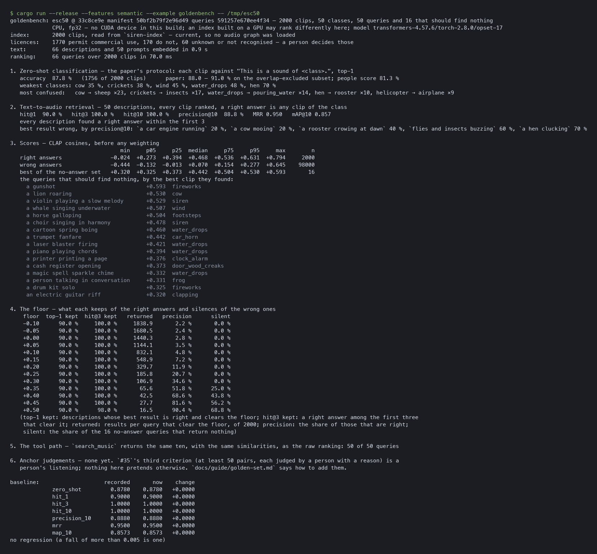

# The golden set

> **What this is.** 2 000 recordings people labelled, two sets of 66 descriptions a developer might type, and one command that runs the
> real model over all of it and prints recall, precision and what a similarity floor keeps and silences. It exists because every number
> the semantic layer used to quote about *quality* came from **six synthetic clips** — and the first time it was run on real
> recordings, it overturned one of them. **Two things to read before quoting a figure:** the headline retrieval numbers are for the
> *maintainer's* wording and fall sharply in a stranger's (§4 below), and [what it cannot say](#what-it-cannot-say).

`#35` asked for a labelled library, text queries with expected answers, and anchor pairs judged by a person. The first two are here;
the third is a person's listening and is not.

| `#35` criterion | state |
|---|---|
| The set's contents are fixed and versioned, with a licence line per asset | **Met.** `golden/esc50/manifest.sha256` pins 2 000 clips, the dataset's labels and its licence by SHA-256 at commit `33c8ce9e`. `licences.csv` is made from the dataset's own `LICENSE` and the fetch **fails** unless every clip has a row: CC0 869, CC-BY 901, CC-BY-NC 170, CC-Sampling+ 60 |
| Every text query has an expected best result and the rationale in one line | **Met, twice**: two files of 66 queries — 50 with right answers, 16 that should find nothing — one in the maintainer's words (`golden/esc50/queries.tsv`) and one paraphrased to avoid the class names (`queries-paraphrase.tsv`). `every_checked_in_query_names_its_answer_and_says_why_and_every_class_is_asked_for` enforces both |
| Every anchor pair has a human judgement and the reason | **Not met, and not a machine's to meet.** No pairs yet. [How to add them](#growing-the-set) |
| Loading the set requires one command and no manual step | **Met.** `python3 tools/fetch_esc50.py <dir>`: 79 s the first time, a second to verify afterwards |

## Run it

```sh
python3 tools/fetch_esc50.py /tmp/esc50            # 2 000 clips, each checked against the manifest as it arrives
python3 tools/export_clap_onnx.py /tmp/clap        # the two graphs and the tokenizer, from your Hugging Face cache
cargo run --release --features semantic --example goldenbench -- /tmp/esc50 \
    --model /tmp/clap/clap-text.onnx --vocab /tmp/clap/tokenizer.json --audio-model /tmp/clap/clap-audio.onnx \
    --model-version "$(cat /tmp/clap/clap-export.txt)"
```

The first run indexes the 2 000 clips (**211 s** on an M4 Pro CPU, 9.5 clips/s — measured while the machine's load average was 6.5, so
read it as an upper bound; `docs/guide/semantic.md` has the quiet-machine figure per clip). Later runs reuse the index and finish in
seconds. With a file missing it says which and exits **2** before loading, building or writing anything; with the library not the
set — a labelled file absent, or a file nobody labelled — it refuses by name, because a partial copy measures a different set.



## What it measured

**1. The pipeline agrees with the reference, on audio iteration 110 could not test.** The paper's zero-shot protocol — each clip
against `"This is a sound of <class>."`, top-1 — gives **87.8 %** (1 756 of 2 000). An independent run of the same audio through
`transformers` (`audio_model(is_longer=False)`, resampled with scipy) gives **87.8 %** too: the same figure to four places, from a
different resampler, on **44.1 kHz** input that the 5 × 14 check at 48 kHz never exercised. Over all 232 000 similarities
(116 strings × 2 000 clips) the crate's differ from `transformers`' by **8 × 10⁻⁴ on average**, **0.03 at the 99.9th percentile**, and
**0.089 at worst**; a typical clip differs by 3 × 10⁻⁴ and one in a hundred by more than 0.008. The disagreement is not digital silence
(Spearman −0.21 against each clip's share of exactly-zero samples), and which of the two resamplers is nearer the one the model was
trained with — `librosa`'s — is **not measured**. It moved one top-1 of fifty (`hit@1` 0.92 in the reference, 0.90 here).

The paper reports **88.0 – 91.0 %** on ESC-50 across its variants (the table is OCR-garbled in the corpus, so which row is
`laion/clap-htsat-fused` is not certain), so 87.8 % is 0.2 points under its lowest figure. The reference's identical result puts that
gap in the checkpoint and the protocol, not in this crate. The weakest
classes are the ones people confuse: `cow` 35 % (23 of 40 read as `sheep`), `crickets` 38 % (→ `insects`), `wind` 45 %, `water_drops` 48 %
(→ `pouring_water`), `hen` 70 % (→ `rooster`). People score 81.3 % on the same labels.

**2. Retrieval, which is what the crate is for.** Fifty descriptions, every clip ranked, a right answer being any clip of the class:

| hit@1 | hit@3 | hit@10 | precision@10 | MRR | mAP@10 |
|---|---|---|---|---|---|
| 90.0 % | **100.0 %** | 100.0 % | 88.8 % | 0.950 | 0.857 |

**In the maintainer's words, every description found a right answer in the first three** (in a stranger's, 84 % did: §4). The five whose first result was wrong are `a car engine running`
(precision@10 20 %), `a cow mooing` (20 %), `a rooster crowing at dawn` (40 %), `flies and insects buzzing` (60 %) and `a hen
clucking` (70 %): a cow's moo ranks sheep first, and an engine ranks other motors. `search_music` returns the same ten, with the same
similarities, as the raw ranking for 50 of 50 queries — the numbers are about the thing a game calls.

**3. The floor, and the claim it overturned.** Until iteration 111 this guide said the right and wrong bands **overlap**, so *"no
single threshold separates them"* and *"a floor of 0.5 rejects every correct match"*. That came from six synthetic clips. On 2 000 real
ones:

| | min | p05 | p25 | median | p75 | p95 | max | n |
|---|---|---|---|---|---|---|---|---|
| right answers | −0.024 | +0.273 | +0.394 | **+0.468** | +0.536 | +0.631 | +0.794 | 2 000 |
| wrong answers | −0.444 | −0.132 | −0.013 | +0.070 | +0.154 | **+0.277** | +0.645 | 98 000 |
| best clip of a no-answer query | +0.320 | +0.325 | +0.373 | +0.442 | +0.504 | +0.530 | +0.593 | 16 |

The bands overlap only in their tails (the right answers' 5th percentile, 0.273, against the wrong answers' 95th, 0.277). The six
synthetic tones' *best* match (0.429) is below the real median: **synthetic audio understates a real match by a wide margin, and a
floor calibrated on it is calibrated on nothing.** What each floor does:

| floor | top-1 kept | hit@3 kept | results per query | precision | no-answer queries silenced |
|---|---|---|---|---|---|
| 0.00 (the default) | 90.0 % | 100 % | 1 440.3 | 2.8 % | 0 of 16 |
| 0.30 | 90.0 % | 100 % | 106.9 | 34.6 % | 0 of 16 |
| 0.40 | 90.0 % | 100 % | 42.5 | 68.6 % | 7 of 16 |
| **0.45** | 90.0 % | **100 %** | **27.7** | **81.6 %** | **9 of 16** |
| 0.50 | 90.0 % | 98 % | 16.5 | 90.4 % | 11 of 16 |

The weakest **top result** of any of the fifty descriptions scores **0.492** — and **0.405** in a stranger's words (§4). A floor on that
top score separates a description the library can answer from one it cannot with an **AUC of 0.963** (0.885 in the stranger's); a
margin over the tenth result does not (0.496 — a coin). The largest floor that keeps every description's top result in *both* wordings
is 0.40, by a margin of 0.005; **0.35 keeps it with 0.055 to spare**. That is the evidence the default floor was waiting for, and the
reason it is now a decision file rather than a number in a doc comment: `docs/loop/needs-decision/default-floor.md`.

**The sixteen that should find nothing find *something*, and it is almost always the confound their rationale names.** A gunshot finds
`fireworks` (0.593), a lion finds `cow` (0.530), a violin finds `siren` (0.529), a whale finds `wind` (0.507), a horse finds `footsteps`
(0.504). The model is not wrong — those are the nearest sounds the library has — and no absolute floor can tell *nearest* from *right*.
The ones a floor does silence are the sounds with no neighbour: an electric guitar (0.320 → `clapping`), a drum kit (0.325), a person
talking (0.331).

**4. Asked in a stranger's words, it is materially worse — and the floor's safe range shrinks.** `golden/esc50/queries-paraphrase.tsv`
describes the same 50 classes without their names (*"a furry pet yapping at the door"*, *"surf rolling up a beach"*, *"ah-choo"*) and
keeps the same 16 no-answer queries. The index and the model are unchanged; only the questions differ:

| | hit@1 | hit@3 | hit@10 | precision@10 | MRR | mAP@10 |
|---|---|---|---|---|---|---|
| the maintainer's words | 90.0 % | 100.0 % | 100.0 % | 88.8 % | 0.950 | 0.857 |
| a stranger's words | **72.0 %** | **84.0 %** | 92.0 % | 73.6 % | 0.791 | 0.676 |

Eight descriptions miss at three, and the misses name an *idea* where the model matched a *sound*: *"the loud morning call of a male
farmyard bird"* finds a right answer at rank 48, *"rockets bursting in the night sky"* at 24, *"summer evening chirping from the
grass"* at 23. The right answers' median falls from 0.468 to 0.402 and their 5th percentile from 0.273 to 0.158, so the bands overlap
more — and the floor curve moves with them:

| floor | top-1 kept (maintainer / stranger) | hit@3 kept | descriptions that still get a result |
|---|---|---|---|
| 0.00 – 0.40 | 90 % / 72 % | 100 % / 84 % | 50 / 50 |
| 0.45 | 90 % / **70 %** | 100 % / **80 %** | 50 / **48** |
| 0.50 | 90 % / **64 %** | 98 % / **70 %** | 49 / **41** |

**This is the most important caveat on every figure above.** The headline retrieval numbers describe friendly wording, and the floor of
0.45 that looked like the knee in the maintainer's wording already deletes answers in the stranger's — which is why the recommendation in
the decision file is 0.35 and not 0.45.

## What it cannot say

- **ESC-50 overlaps the model's training data.** The paper's own overlap table lists ESC-50 clips shared with Clotho and with FSD50K
  (399 in its training split alone) and the paper *excluded* them from its zero-shot figure. This set does not, so absolute scores
  here are optimistic for the shipped checkpoint. What it measures soundly is **agreement with the reference** and the **shape** of the
  floor curve; what it cannot is how a *new* sound will score.
- **One library of environmental recordings.** No music, no speech, no long tracks, no stereo, nothing synthesised, no game foley
(impacts, whooshes, UI blips). `#35`'s own pitfall: *a set drawn from one library measures that library*. Any floor is a number about
ESC-50 until a game-like library says otherwise.
- **The descriptions were written by one person** with the class list in view. Fifty queries move in steps of 2 points, and a second
  wording by the same hand moved hit@3 from 100 % to 84 % (§4): a third writer would move it again.
- **The no-answer queries are sixteen, and several have a real neighbour.** `silent` is a lower bound on what a floor can do and a coarse
  one.
- **Nothing here judges whether two sounds *fit*.** Right means *same class*; whether a neighbour belongs beside an anchor — `#39`'s
  question and `#35`'s third criterion — is a person's call.

## Growing the set

**A text query**: add a row to `golden/esc50/queries.tsv` — `target`, `class`, `description`, `rationale`. Descriptions are unique (the
loader refuses a repeat, naming both lines), a row without a rationale is refused, and a class no file is labelled with is refused rather
than blamed on the model. **Never edit a recorded query in place**: add a new row, because the baseline is about the old one.

**A query that should find nothing**: `target` and `class` of `-`, and a rationale that names the nearest confound (*"`fireworks` is the
nearest impulsive bang"*) so a reader of a result knows what the model found instead.

**A second wording** is the cheapest way to test whether a number is robust: describe the same classes without their names
(`queries-paraphrase.tsv` is the model) and run `goldenbench <dir> --queries <file>`. The baseline is for the default queries only, so
another file is measured and compared with nothing, and `--bless` refuses it.

**A second library**: a directory of audio, a `labels.csv` (`file,class` — a dataset's own `filename,…,category` CSV reads too), and a
queries file with the same columns, then `goldenbench <dir> --queries <file>`. The loader checks the two against each other and against
the directory. Record its licences in a `licences.csv` beside the audio so every result carries them. **This is the most useful next
addition**: music, speech, and game-style foley are what the set above cannot say anything about.

**Anchor pairs — the part a person does.** For each of at least ten anchors: list its nearest neighbours (`examples/audition` prints them
in rank order with their scores), listen to each beside the anchor (`afplay`), and record one line per pair —
`anchor<TAB>neighbour<TAB>fits | does not fit<TAB>why` — with paths relative to the library. A pair with no reason is not a judgement.
`#35` asks for at least 50. **The loader and the metric are not built**: `eval::agreement` counts affirmed neighbours ranked above the
anchor, which an anchor queried with itself can never score (`evalbench`'s first run found that), so the right metric for real pairs is a
decision to make with the first real judgements in hand, not before.

## Licence and integrity

The dataset as a whole is **CC BY-NC 3.0**; its ESC-10 subset CC BY 3.0; each clip keeps its Freesound licence. So it is **fetched, never
vendored or packaged** (`Cargo.toml`'s `include` does not name `golden/`'s audio, and the repository holds none). The manifest records a
SHA-256 per file, compared against a value *in this repository* — ADR 0005's rule that a hash delivered beside the payload verifies nothing —
and a downloaded file that disagrees is refused by name and never written. A file that is in the directory and not in the set is refused
too, because it would join every ranking as a wrong answer. Two quirks of the dataset's own `LICENSE` were found by this check and are
named in `tools/fetch_esc50.py` rather than papered over: one clip is listed as `5-141683-Ad` (a typo for `5-141683-A`, and the row's
Freesound id is checked against the clip's), and one title is written `[DrinkingCan[Norberd]](url)`.

**What the crate makes of the real sidecar.** Joined into the index, the 2 000 licence lines read as **1 770 that permit commercial use**
(CC0 869, CC-BY 901), **170 that do not** (CC-BY-NC, by each clip's own Freesound licence) and **60 unknown** (CC-Sampling+, which
the crate does not recognise and so never presents as permissive) — the distinction `#14` exists to keep, from real data rather than a
fixture. `goldenbench` prints that line on every run.
