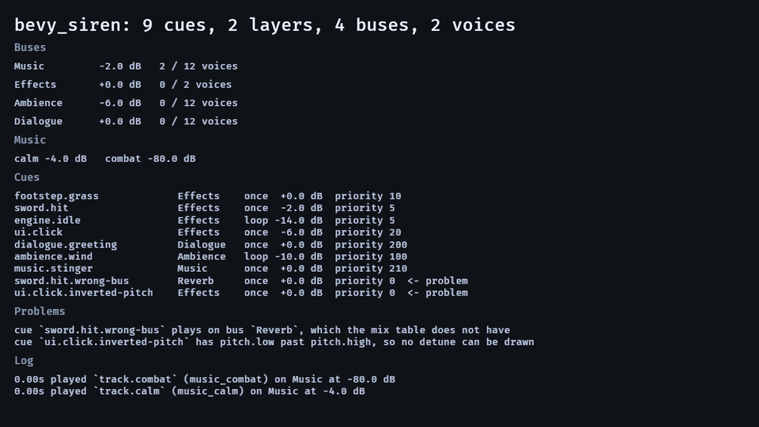
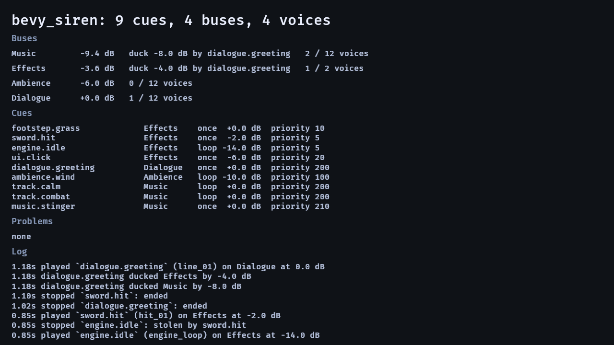

# Media

Every file here was captured from `examples/mixer` on macOS (arm64, Bevy 0.20, `bevy_siren` 0.1.0) with the commands
below. A media file a published README names is never moved; a re-capture replaces it in place.

## No clip: iteration 28, a despawned voice frees its mixer slot

No clip: the change is **which calls reach the mixer backend**, and every rendered cue is byte-identical (21 of 21) —
`examples/render` runs on Bevy's path, where the leak never existed. The evidence is
`runs/2026-11-03-28/evidence/mixer-slot{,-before}.txt`, a fake `AudioOutput` recording `stop_voice`: before, one started
voice and its owner despawned leaves `stop_voice []`; after, `[0]` — exactly once — while a voice whose owner is still
alive stays `[]`. Test: `tests/mixer.rs::a_despawned_voices_mixer_slot_is_freed` (behind `mixer`; fails on the base commit).

## No clip: iteration 27, a duck ends its hold when its voice does

No clip: the change is **when a duck's hold releases**, and every rendered cue is byte-identical (21 of 21) because the
harness's scripted duck still has a live voice while it plays. The evidence is
`runs/2026-11-03-27/evidence/duck-hold{,-before}.txt`, four cases over 70 frames: a **stopped** source goes to `+0.0` at
frame **40** (was 60), while a looping source, a second line mid-hold, and a one-shot that ends by itself are **unchanged**
— one row of four. Tests: `tests/mix.rs::{a_duck_ends_its_hold_when_its_source_is_stopped,
a_duck_whose_source_keeps_playing_holds, a_second_line_extends_the_duck}`.

## `mixer.gif` and `mixer.png` — the audio panel, as a program





The crate's visible harness: every bus with its level, its duck and its live voice count; the cue table **with the
crate's own verdict on it** (`Problems`, and `<- problem` beside a cue that cannot play); the log of what played and why —
driven by a scripted run so the capture shows a duck firing, a voice being stolen, and a music layer entering on the bar.

The GIF is captured with `SIREN_FAULTS=1`, which adds two deliberate mistakes to the table so the `Problems` block and
the row markers have something to show through the whole animation. The **still** is the clean panel, which reads
`Problems / none` — that is the state a project ships, and it is what `README.md` shows at rest.

The log shows **eight** lines — `SirenLog::CAPACITY`'s own doc says *"a panel shows eight"*, and the column fits about
8.5: at ten the last entry was clipped mid-glyph in every capture until iteration 32.

A bus row reads `duck -8.0 dB by dialogue.greeting` while a duck holds — how far *and* by what, from the `Entry::Ducked`
the log already carries (iteration 31) — and drops the clause the frame the duck releases.

The panel's `Problems` block is **bounded at three sentences** (iteration 30): with more it prints
`and N more; the log below is what played`, because the column has no scroll and the log — the section that says what played
and why — sits below it. `SIREN_FAULTS=many` adds six faults, so the bound can be seen firing.

**Both must be regenerated whenever the panel's layout changes** — iteration 26 added the `Problems` block and the
row markers, and the two images the README pointed at were a day stale until iteration 29. Nothing in `cargo test` reads
`docs/`; `docs/loop/runs/2026-11-03-29/check_media.py` asserts that every image a README names exists and that every
image here is named by one.

```sh
cargo run --release --example mixer            # the panel, interactive
SIREN_FAULTS=1 SIREN_FRAMES=200 SIREN_SIZE=1280x720 SIREN_SHOT_DIR=/tmp/frames SIREN_SHOT_FROM=30 \
  SIREN_SHOT_EVERY=10 cargo run --release --example mixer   # 18 frames at 6 fps
ffmpeg -y -framerate 6 -i /tmp/frames/f_%04d.png \
  -vf "scale=960:-1:flags=lanczos,split[a][b];[a]palettegen[p];[b][p]paletteuse" -loop 0 docs/media/mixer.gif

SIREN_FRAMES=140 SIREN_SHOT=docs/media/mixer.png SIREN_SIZE=1280x720 \
  cargo run --release --example mixer          # the still
```

Iteration 25 gave the capture a **default script**: `SIREN_KEYS` unset used to panic on `% 0` and write no still, so
until then this harness could not produce a picture at all. `SIREN_KEYS=steal,layer,duck` is the default; a token it does
not know prints one line and stages that default.

## No clip: iteration 24, a refusal outlives a burst of plays

No clip: the change is **which entry leaves a full `SirenLog`**, and every rendered cue is byte-identical (21 of 21) —
the log is not the mix. The evidence is `runs/2026-11-03-24/evidence/refusal-lifetime{,-before}.txt`: before, one refusal
was evicted after **256 plays** (0.40 s at 640 entries/s); after, it survives **2000** and leaves only when 256 *routine*
entries have accumulated, with the 600-refusals and 1000-mixed-pushes rows unchanged. Tests:
`tests/model.rs::{a_refusal_outlives_a_burst_of_plays, the_buffer_never_exceeds_its_capacity,
a_log_of_only_refusals_still_evicts, entries_stay_in_order_after_an_eviction}`.

## No clip: iteration 23, the seed the stream was built from

No clip: the change is **what `seed()` answers**, and every rendered cue is byte-identical (21 of 21) because no sound
moves. The evidence is `runs/2026-11-03-23/evidence/seed{,-before}.txt`: before, a project writing `seed: 0` and one
taking the default heard the **same stream** while `SirenChoices::seed()` reported `0` and `6840213216811810817`
respectively; after, both report `6840213216811810817`, which is what the stream started at. Tests:
`tests/model.rs::{a_zero_seed_reports_the_seed_it_used, a_nonzero_seed_reports_itself,
a_streams_seed_does_not_move_as_it_draws, a_zero_seed_and_the_default_seed_are_one_stream}`.

## No clip: iteration 22, `AvoidRepeat` avoids the sound rather than the index

No clip: the change is **which variant the picker refuses**, and every rendered cue is byte-identical (21 of 21) because
no fixture cue lists a duplicate key. The evidence is `runs/2026-11-03-22/evidence/duplicate-keys{,-before}.txt`: with
`Repeat::AvoidRepeat { avoid: 1 }`, a cue of `["a", "a", "b"]` had **3 adjacent repeats** before and **0** after, and
`["a","a","a","b"]` had **8** and **0**, with the distinct-key and one-sound controls unmoved. Tests:
`tests/play.rs::{a_duplicate_key_never_repeats_under_avoid_repeat, a_cue_of_one_sound_still_repeats,
a_duplicate_key_still_plays_its_own_sound, pick_without_keys_still_avoids_indices}`.

## No clip: iteration 21, the wrapper that cannot see a project's own buses

No clip: the change is **which call the panel makes**, and every rendered cue is byte-identical (21 of 21) — a report, not
a sound. The evidence is `runs/2026-11-02-21/evidence/custom-buses.txt`: with a `Sfx` bus,
`table.problems()` prints *"cue `gunshot` plays on bus `Sfx`, which the mix table does not have"* for a cue the crate
**accepts**, and `table.problems_in(&settings)` prints nothing. Test:
`tests/mix.rs::problems_in_reads_the_tables_own_buses`, plus the compiled doctest on `problems_in`. The Cauldron's audio
panel now calls `problems_in(&read)`; its own commit is in `bevy_grimoire`.

## No clip: iteration 20, the report agrees with the mix about buses

No clip: the change is **which sentences `problems()` produces**, and every rendered cue is byte-identical (21 of 21) —
the report does not touch the mix. The evidence is `runs/2026-11-02-20/evidence/report{,-before}.txt`, four tables: before,
`buses: []` produces **4 false sentences** and a two-bus table prints `Dialogue` **twice**; after, **0** and **1**, with
the genuinely-absent-bus table still reporting, once. Tests:
`tests/mix.rs::{an_empty_bus_list_reports_no_bus_problems, the_default_ducks_name_their_missing_source_once,
a_duck_naming_a_missing_bus_is_still_reported, a_default_table_reports_nothing}`.

## No clip: iteration 19, a music layer's gain that is not a number

No clip: the change is **which number a layer holds and what `layer_db` reports**, and every rendered cue is
byte-identical (21 of 21) because no rendered cue had a `NaN` layer gain. The evidence is
`runs/2026-11-02-19/evidence/music-gain{,-before}.txt`: before, `layer_db NaN` with `Voice.base_db NaN` while `Applied`
was `-80.0` and `problems()` was empty; after, all three are `0.0` and one sentence names the layer — with the
`SILENT_DB` row unmoved as the guard. Tests:
`tests/music.rs::{a_layer_whose_starting_gain_is_not_a_number_starts_at_zero,
a_move_to_a_gain_that_is_not_a_number_arrives_at_zero, a_score_reports_a_layer_gain_that_is_not_a_number,
a_silent_layer_is_still_silent}`.

## No clip: iteration 18, a gain that is not a number

No clip: the change is **which number reaches the sink and what `Played` reports**, and every rendered cue is
byte-identical (21 of 21) because no rendered cue was authored with a `NaN`. The evidence is
`runs/2026-11-02-18/evidence/nan.txt`: before, `gain NaN` reports `gain -80.00` (silent, and the meter says it is a level);
after, `gain 0.00`. Pitch: before `pitch NaN` reports `NaN` and `pitch 1e9` reports `1000000000.00` — for a sound playing
at `1.0×` and `16×` respectively; after, `0.00` and `48.00`. Tests:
`tests/play.rs::{a_gain_that_is_not_a_number_is_no_gain, a_plays_gain_that_is_not_a_number_is_no_gain,
a_pitch_that_is_not_a_number_reports_the_speed_it_plays_at, a_silent_bus_still_silences_its_voices}`.

## No clip: iteration 17, the backend flag does not decide ownership alone

No clip: the change is **which entity component a voice gets**, visible only as a missing or present `AudioPlayer`,
and every rendered cue is byte-identical (21 of 21) because no rendered cue was in the lost state. The evidence is
`runs/2026-11-02-17/evidence/backend{,-before}.txt`: before, `Backend(true)` with no `Output` printed
`AudioPlayer 0` — silent and unretirable — and after prints `AudioPlayer 1`, while the `Backend(true)` **with** an
`Output` row stays `0`. Tests: `tests/play.rs::{a_backend_with_no_output_still_gives_the_voice_a_player (fails before),
a_backend_with_an_output_leaves_the_voice_to_the_mixer (the guard)}`.

## No clip: iteration 16, a layer that names a cue which ends

No clip: the change is **a play that is not written**, so nothing is rendered and every WAV is byte-identical (21 of
21). The evidence is `runs/2026-11-02-16/evidence/one-shot-layer{,-before}.txt`: before, a `Mode::Once` layer plays
**10 times in 10 frames** with no line at all; after, **0 plays** and one sentence in `problems()`' words, with the
`Mode::Loop` and unknown-cue rows unmoved as controls. Tests:
`tests/music.rs::{a_layer_whose_cue_is_not_a_loop_is_not_started, a_not_a_loop_layer_is_noted_once,
a_layer_whose_cue_becomes_a_loop_starts}`.

## No clip: iteration 15, a stem whose voice dies

No clip: the change is **what happens when a music layer's voice dies**, and it happens on a frame — nothing is
rendered, so every WAV is byte-identical (21 of 21). The evidence is a scripted probe,
`runs/2026-11-02-15/evidence/layer-voices{,-before}.txt`, which on the unfixed tree prints
`voices ["ui.click"] … steals ["track.calm stolen by ui.click"]` — the stem gone, the layer still saying it plays — and
after prints `voices ["track.calm"] … steals []`. Every row is a test:
`tests/music.rs::{a_one_shot_cannot_steal_a_music_layer, a_layer_whose_voice_died_is_restarted,
a_layer_the_game_stopped_stays_stopped, a_refused_layer_start_is_tried_again_when_room_frees}`.

## No clip: iteration 14, a score edit reconciles its voices

No clip: the change is **what happens to a voice when the score changes**, and every rendered WAV is byte-identical
because the harness plays no edited score. The evidence is the two probes in
`runs/2026-11-02-14/perf.md` — a removed layer leaving **2** voices live before and 1 after, a retargeted layer playing
`track.a` before and `track.combat` after — and the three tests, two of which fail on the unfixed tree. A panel could show
it only if `examples/mixer` edited its score at runtime, which it does not.

## No clip: iteration 13, the cap is a budget on plays

No clip: the change is **two doc sentences and two tests**. No behaviour moved, so every rendered WAV is byte-identical
and `examples/music` still prints *"transitions on the bar: yes"*. The evidence is the probe
(`runs/2026-11-02-13/eval.md`: two voices sounding against a cap of one, the next play refused) and the mutation in
`perf.md`, which shows the new test catches a "reconcile by ending" implementation.

## No clip: iteration 12, a stale handle stops nothing

No clip: the change is a **guard on a command**, and every rendered WAV is byte-identical because no level that is written
moves. The evidence is a crash and its absence — `tests/play.rs::a_stop_for_an_ended_voice_is_a_no_op` panics inside
`app.update()` on the unfixed tree (`Entity despawned … its index now has generation 1`) and returns on the fixed one.
Neither a still nor a GIF can show a panic that is no longer there; `runs/2026-11-02-12/perf.md` carries the two outputs.

## No clip: iteration 11, the rule written the way it reads

No clip, and **no code**: this iteration changes tests and a case table's observation, not behaviour. Every rendered WAV
is byte-identical because `src/` is byte-identical. The evidence is the mutation in
`runs/2026-11-02-11/perf.md` — removing `steal`'s `!c.unstealable` filter reddens both new tests **and**
`the_table_budget_refuses_rather_than_grow`, which is what makes the claim honest: the suite already covered the rule,
and the new tests make it legible rather than closing a hole.

## No clip: iteration 10, the mix forgets a bus that left

No capture: the change is **which keys a map holds**. Every rendered WAV is byte-identical because no level that is
written to a sink moved — the bug lived in `SirenMix`, the readable copy the panel and a game's meter use. The evidence
is `tests/mix.rs::{a_bus_that_left_the_table_leaves_the_mix, an_empty_bus_list_still_means_the_crates_four}` (both fail
on the unfixed tree) and `runs/2026-11-02-10/perf.md`'s probe pairs.

A capture that *would* show it: the panel with a project whose `family/bevy_siren.ron` lists two buses while a previous
scene's four were in the mix — the stale rows would draw with old levels. `examples/mixer` never swaps its table, which
is why no still exists.

## No clip: iteration 9, a duck that waits for a sound

No capture: the change is **when a duck is armed**, and the panel's bus row settles to the same value either way once
the frame is over — the bug lived for the length of one frame and in the log, where `stinger ducked Music by -9.0 dB`
sat beside `refused … no handle …`. Every rendered WAV is byte-identical. The evidence is
`tests/music.rs::{a_stinger_whose_cue_is_unknown_ducks_nothing, a_stinger_whose_sound_is_missing_ducks_nothing}` (both
fail on the unfixed tree) and `runs/2026-11-02-09/perf.md`'s probe pair.

A capture that *would* show it: the panel's log pane with a stinger whose file is missing — one line, not two. That is
the same scripted-capture gap the last five iterations have named.

## No clip: iteration 8, a position a non-spatial cue does not have

No capture: the change is **which backend flag a voice is spawned with**, and every rendered WAV is byte-identical —
the crate's own mixer does not pan at all, and `examples/mixer` runs Bevy's path over cues that are all `spatial: false`
played *without* a position, so nothing in the panel's script hits the mismatch. The evidence is the
`tests/play.rs::a_non_spatial_cue_ignores_a_position` failure on the unfixed tree (*"a non-spatial cue is not routed
through the panner"*) and `render.txt`'s panner line, **0.0117 linear, −38.7 dB at 8 m** — the falloff a "flat" cue was
secretly given.

A capture that *would* show it: a cue list row for a `spatial: false` cue auditioned at a position, with the panel
showing its `Played.gain_db` against a level meter. That needs a meter on the panel, which is the same gain-history
strip the last four iterations have proposed.

## No clip: iteration 7, a reused voice slot

No capture: the change is **memory**, not sound. Every rendered WAV is byte-identical, and the panel draws the same
live-voice count because that count was never wrong — it was the backend's retained list behind it that grew. The
evidence is `docs/loop/runs/2026-11-02-07/perf.md`: on this Mac's real audio device, 400 one-shots held **400 slots**
before and **6** after, with the same 400 distinct *names* in both trees.
`tests/mixer.rs::a_slot_is_reused_and_a_stale_index_addresses_nothing` asserts the three facts together, and skips with
a sentence on a machine with no device.

A capture that *would* show it: a memory strip in `examples/mixer` — resident bytes over a long run of one-shots — which
would rise until the run ends before, and flatten after. That needs a long run and a process-memory probe, neither of
which the panel has.

## No clip: iteration 6, a refused sample names the sound

No capture: the change is **text** — one refusal sentence and the key inside it — and a still of the panel cannot show
it. The evidence is `docs/loop/runs/2026-11-02-06/evidence/{before,after}/missing-sound.txt`: two lines, one per cause,
where the before tree names `step_03` for a missing handle and `footstep.grass` for undecodable bytes, and the after
tree names `step_03` both times. `tests/mixer.rs::a_sample_the_decoder_refuses_names_its_sound_key` fails on the
unfixed tree with exactly that pair.

A capture that *would* show it: the panel's log pane with a broken file in the project — the `Refused` line names
`step_03`, and a project can open the file it names. That is a scripted capture against a deliberately corrupt asset,
which the panel has no knob for yet.

## No clip: iteration 5, a refusal that names the cap that refused

No capture: the change is **text**, and the panel's log tail is the same rectangle before and after unless a project
happens to be refusing at that instant. The evidence is
`docs/loop/runs/2026-11-02-05/evidence/{before,after}/refusals.txt` — three lines, two shapes where there was one —
and `tests/mix.rs::{a_full_table_budget_names_no_bus, a_cue_at_its_own_polyphony_names_no_bus,
a_full_bus_names_that_bus}`, two of which fail on the unfixed tree.

A capture that *would* show it: the panel's log pane while `budget --probe` forces each cap, with the three lines
readable at 1280×720. That needs the panel to render `Refused` sentences from a live refusal, which it does — the gap
is a scripted capture, not the code.

## No clip: iteration 4, a crossfade that takes the time it was given

No capture, for the same reason as iteration 3: the change is a **gain envelope over time**, and `examples/mixer` draws
`SirenMix` as live numbers rather than history. The evidence is the plot,
`docs/loop/runs/2026-11-02-04/evidence/plots/layer-fade-zoom.svg` — blue (`fade_s(0.8)`) still rising where red
(`MIX_TAU_S`) flat-lines — and `tests/music.rs::a_layer_takes_the_fade_it_was_given`, which fails on the unfixed tree.
The panel would show the same "moving" count and the same final dB before and after; only the *time* differs, and a
still has no time in it.

The gain-history strip proposed here in iteration 3 would show this too. It remains the first thing to add when the
panel next grows.

## No clip: iteration 3, the seed and the stinger's hold

Also no capture, and for a different reason than iteration 2. The stinger's fix is a **bus gain envelope**, and
`examples/mixer`'s panel draws `SirenMix::ducked` as a live number, not as a plot — a still would show "−9.0 dB" at
one instant, which the old code also showed on the frame the stinger fired. The shape is the evidence, and it is
`docs/loop/runs/2026-11-02-03/evidence/plots/stinger-envelope-zoom.svg`: the hold is the flat floor from 1.2 s to
1.6 s, and the before curve is already climbing there. The seed fix produces no image at all — it is two `Played`
streams — and its evidence is
`tests/play.rs::{a_projects_seed_reaches_the_stream, changing_the_seed_restarts_the_stream}`.

A capture that *would* show the stinger: add a **gain-history strip** to `examples/mixer` — a small line plot of
`SirenMix::bus_db("Music")` over the last two seconds — beside the bus rows. That is an example change with its own
drawing work, and it is the first thing to add when the panel next grows.

## No clip: iteration 2, a voice that ends frees its slot

There is no capture for the `mixer` backend's voice retirement, and the reason is the machine: the `mixer` example
runs Bevy's default audio path, so a picture of it cannot show which backend retired a voice, and a headless capture
on a Mac with no audio device would exercise the fallback path instead of the fix. The evidence is instead
`docs/loop/runs/2026-11-02-02/evidence/{before,after}/{steady,lockout}/budget.svg` — the live voice count and the
`VoiceLimit` refusals over a run of one-shots — and the tests
`tests/mixer.rs::{a_one_shot_voice_ends_and_frees_its_slot, a_loop_voice_is_not_retired_when_its_source_ends,
a_stopping_voice_is_not_retired_as_ended, a_music_layer_moves_its_mixer_voice}`.

A capture that *would* show it: run `examples/mixer` with `--features mixer`, fill the Effects cap, and photograph the
panel's voice count falling as each footstep ends. That needs an audio device in the capture environment and is the
first thing to add to `examples/mixer` when one is available.

| File | What it shows | Captured |
|---|---|---|
| `mixer.png` | The audio panel at frame 240 of a scripted run: four bus rows with their levels, the dialogue duck on the music, a bus at its cap after a steal, the cue table and the log tail. 1280 × 720. | 2026-11-02 |
| `mixer.gif` | The same run as motion, 960 px wide: the duck arriving and recovering, the steal, and the combat layer entering on the bar. | 2026-11-02 |

## Regenerating

Build once in release (the capture runs 240 frames, and the debug build's frame times are not the ones the panel's
`mean_ms` line should report):

```sh
cargo build --release --examples
```

**The still:**

```sh
SIREN_FRAMES=240 SIREN_SHOT=docs/media/mixer.png \
  SIREN_KEYS=steal,layer,duck SIREN_KEY_EVERY=25 SIREN_SIZE=1280x720 \
  cargo run --release --example mixer
```

**The frames for the GIF**, then the palette command the Coven uses for every GIF (a per-clip palette, so the flat
panel greys do not band):

```sh
rm -rf /tmp/siren-gif && mkdir -p /tmp/siren-gif
SIREN_FRAMES=240 SIREN_SHOT=/tmp/siren-gif/still.png SIREN_SHOT_DIR=/tmp/siren-gif \
  SIREN_SHOT_FROM=30 SIREN_SHOT_EVERY=2 SIREN_KEYS=steal,layer,duck SIREN_KEY_EVERY=25 SIREN_SIZE=1280x720 \
  cargo run --release --example mixer

ffmpeg -y -framerate 30 -pattern_type glob -i '/tmp/siren-gif/f_*.png' \
  -vf "fps=15,scale=960:-1:flags=lanczos,split[a][b];[a]palettegen=max_colors=192[p];[b][p]paletteuse=dither=sierra2_4a" \
  docs/media/mixer.gif
```

Check the result with `read docs/media/mixer.gif` before committing it: a bus row whose dB disagrees with the panel's
own `SirenMix`, or a log pane whose lines do not match `SirenLog`, is a defect in the example and not a bad capture.
The GIF must stay under 4 MB and 960 px wide; `ffprobe docs/media/mixer.gif` prints both.
